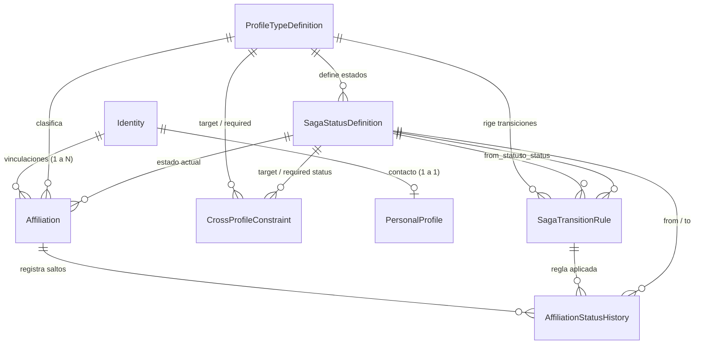
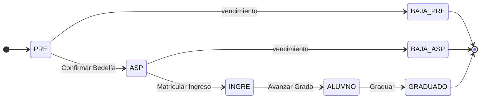
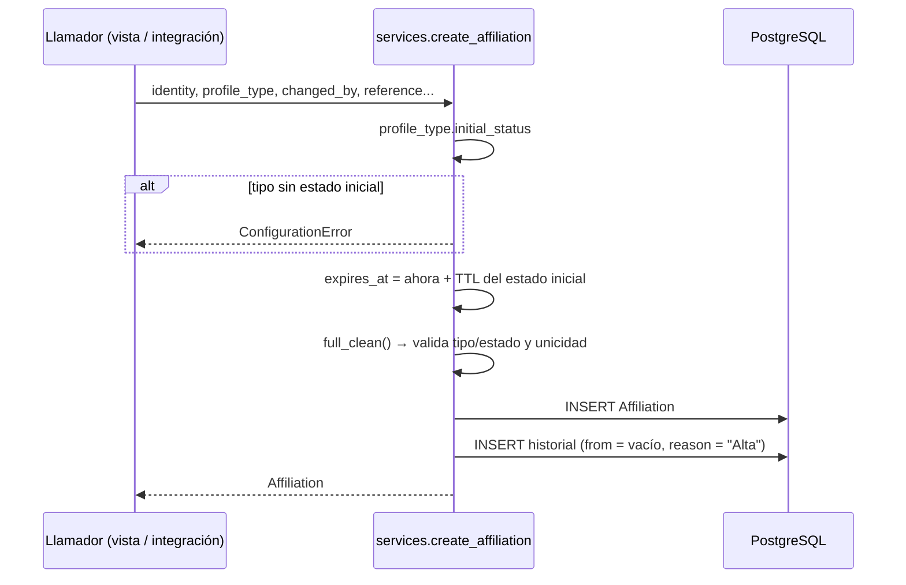
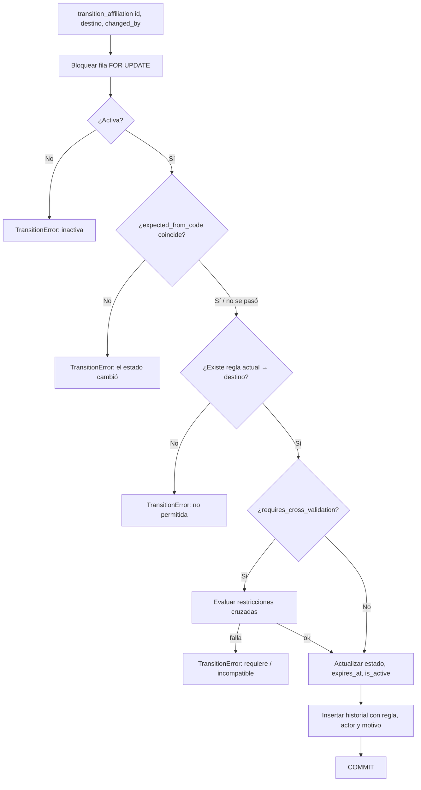
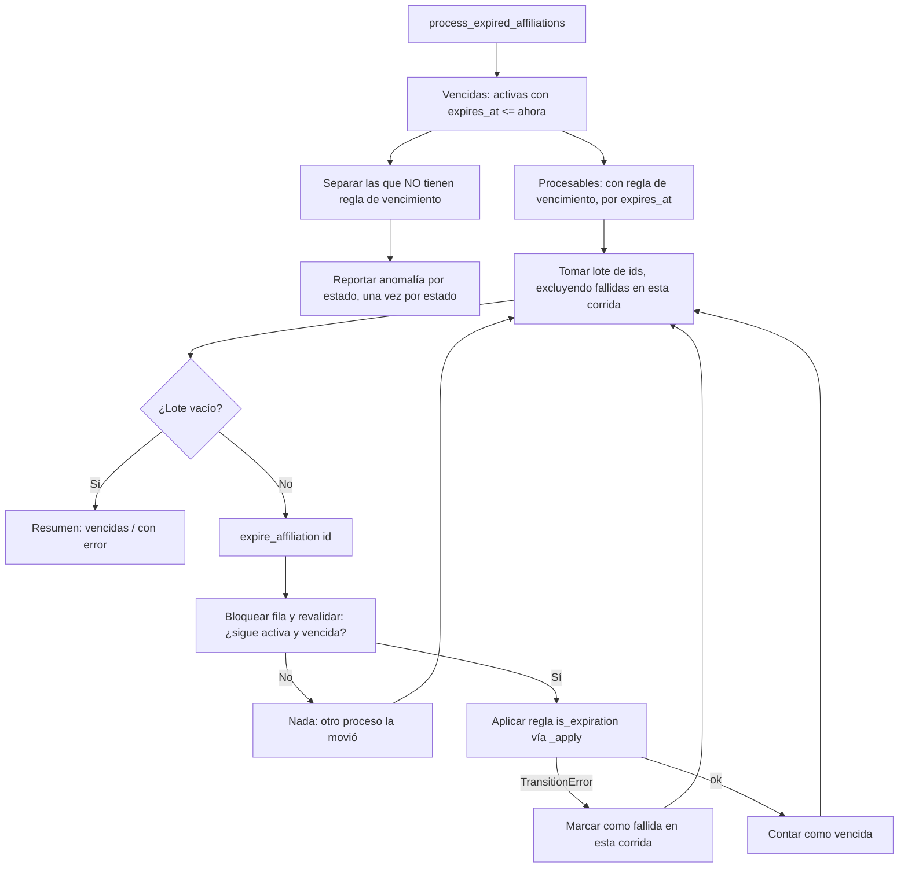

# 01_01 — Entidades base y diseño

**Módulo:** `apps.people` — Identidades, vinculaciones y ciclo de vida
**Sistema:** Lucy — orquestación de identidades — FCE / UNRC
**Archivos documentados:** `models.py`, `services.py`, `management/commands/process_expired_affiliations.py`
**Estado:** diseño aprobado, previo a la migración inicial

---

## Índice

1. [Para qué existe este módulo](#1-para-qué-existe-este-módulo)
2. [La idea en un párrafo](#2-la-idea-en-un-párrafo)
3. [Glosario](#3-glosario)
4. [Arquitectura en tres capas](#4-arquitectura-en-tres-capas)
5. [Patrones de diseño utilizados](#5-patrones-de-diseño-utilizados)
6. [Entidades, una por una](#6-entidades-una-por-una)
7. [Invariantes: qué nunca puede ser falso](#7-invariantes-qué-nunca-puede-ser-falso)
8. [Flujos](#8-flujos)
9. [Metamodelo semilla de la FCE](#9-metamodelo-semilla-de-la-fce)
10. [Decisiones de diseño y alternativas descartadas](#10-decisiones-de-diseño-y-alternativas-descartadas)
11. [Guía práctica para quien toque el código](#11-guía-práctica-para-quien-toque-el-código)
12. [Errores frecuentes que este diseño impide](#12-errores-frecuentes-que-este-diseño-impide)
13. [Decisiones pendientes](#13-decisiones-pendientes)

---

## 1. Para qué existe este módulo

Todo el sistema de gestión necesita responder a una pregunta básica: **¿quién es esta persona o esta unidad, y qué relación tiene hoy con la Facultad?**

La respuesta no es simple:

- Una misma persona puede ser alumna de dos carreras, docente y graduada de una tercera, al mismo tiempo.
- Una cátedra o una secretaría también necesita identidad propia: tiene cuenta institucional, buzón y equipos en Teams.
- Las relaciones cambian con el tiempo: un aspirante pasa a ingresante y luego a alumno; un docente cesa.
- Algunas relaciones caducan si nadie las confirma: un preinscripto que nunca se presentó no puede quedar "activo" para siempre.
- Cada cambio tiene que poder reconstruirse ante una auditoría: quién lo hizo, cuándo, por qué y bajo qué regla.

Este módulo resuelve eso. Es la base sobre la que se apoya el aprovisionamiento de Lucy: los estados de cada `Affiliation` determinan qué cuentas, licencias y matriculaciones deben existir en los sistemas externos (Microsoft 365, Moodle, correo).

Responde a estos principios de diseño:

| Principio | Cómo se cumple acá |
|---|---|
| Dato único y reutilizable | Una persona es una sola `Identity`, sin importar cuántos vínculos tenga. |
| Identidad separada de situación | `Identity` no cambia; lo que cambia son sus `Affiliation`. |
| Historial antes que sobrescritura | Cada cambio de estado deja una fila inmutable en `AffiliationStatusHistory`. |
| Estados derivados antes que manuales | El vencimiento por TTL lo calcula y aplica un proceso automático. |
| Las reglas estructurables se codifican | Las transiciones permitidas y las restricciones cruzadas son datos evaluables. |
| Diseño extensible | Un tipo de vínculo nuevo se carga como datos, sin tocar código. |
| Toda operación debe poder reconstruirse | Historial con actor, regla aplicada, motivo y momento exacto. |

---

## 2. La idea en un párrafo

> Una **identidad** (persona o unidad) tiene una o más **vinculaciones** con la institución. Cada vinculación es de un **tipo** (ALUMNO, PROFESOR…) y está en un **estado** (PRE, ASP, ALUMNO…). Los estados posibles, los saltos permitidos entre ellos, cuánto dura cada estado y qué condiciones deben cumplir las otras vinculaciones de la misma identidad **no están escritos en el código: están cargados en tablas**. El código solo sabe *aplicar* esas reglas. Cada salto queda registrado para siempre.

Si de este documento se recuerda una sola cosa, que sea esta: **el código es el motor; el grafo de estados es el combustible y vive en la base de datos.**

---

## 3. Glosario

| Término | Significado |
|---|---|
| **Identidad** (`Identity`) | Quién es. Una persona física (por DNI) o una unidad organizacional (por código de área). No cambia. |
| **Vinculación** (`Affiliation`) | Una relación concreta de una identidad con la institución: *esta persona, como alumna, de esta carrera*. Tiene estado y ciclo de vida. |
| **Tipo de perfil** (`ProfileTypeDefinition`) | Clase de vinculación: ALUMNO, PROFESOR, POSGRADO, INSTITUCIONAL. |
| **Estado** (`SagaStatusDefinition`) | Situación en la que puede estar una vinculación de cierto tipo: PRE, ASP, INGRE… |
| **Transición / regla** (`SagaTransitionRule`) | Salto permitido de un estado a otro dentro del mismo tipo. Lo que no está declarado, está prohibido. |
| **Restricción cruzada** (`CrossProfileConstraint`) | Condición sobre *otras* vinculaciones de la misma identidad para poder entrar a un estado. |
| **Estado inicial** | Estado en que nace toda vinculación de ese tipo. Hay exactamente uno por tipo. |
| **Estado terminal** | Estado del que no sale ninguna transición. Entrar en él desactiva la vinculación (`is_active=False`). |
| **TTL** (*time to live*) | Días que una vinculación puede permanecer en un estado antes de vencer. Se define por estado. |
| **Regla de vencimiento** | Transición marcada con `is_expiration=True`: la que se aplica automáticamente cuando vence el TTL. |
| **Barrido** (*sweeper*) | Proceso periódico que busca vinculaciones vencidas y les aplica su regla de vencimiento. |
| **Metamodelo** | El conjunto de tablas de configuración (tipos, estados, reglas, restricciones). Es un modelo que describe a otro modelo. |
| **Saga** | Nombre heredado para referirse al ciclo de vida de una vinculación. En sentido estricto no es el patrón *Saga* de transacciones distribuidas; acá significa "recorrido por estados". Se conserva el prefijo en los nombres de clase por continuidad. |
| **Append-only** | Tabla en la que solo se agregan filas: nunca se modifican ni se borran. |

---

## 4. Arquitectura en tres capas

```
┌──────────────────────────────────────────────────────────────────┐
│  CAPA 1 — METAMODELO (configuración)                             │
│  ProfileTypeDefinition · SagaStatusDefinition                    │
│  SagaTransitionRule · CrossProfileConstraint                     │
│  → Lo edita un administrador. Cambia poco. Define las reglas.    │
├──────────────────────────────────────────────────────────────────┤
│  CAPA 2 — OPERACIÓN (datos vivos)                                │
│  Identity · PersonalProfile · Affiliation                        │
│  → Cambia todos los días. Siempre obedece a la capa 1.           │
├──────────────────────────────────────────────────────────────────┤
│  CAPA 3 — AUDITORÍA (memoria inmutable)                          │
│  AffiliationStatusHistory                                        │
│  → Solo crece. Nunca se edita ni se borra.                       │
└──────────────────────────────────────────────────────────────────┘

        services.py  ← único lugar que mueve datos de la capa 2
                        y escribe en la capa 3, consultando la capa 1
```

### Diagrama entidad-relación



### Reglas de dependencia entre capas

- La capa 2 **referencia** a la capa 1 (cada vinculación apunta a un tipo y a un estado), pero nunca la modifica.
- La capa 3 **referencia** a las capas 1 y 2, pero ninguna de ellas depende de la capa 3.
- Todas las claves foráneas hacia la configuración usan `on_delete=PROTECT`: **no se puede borrar un estado o una regla que ya fue usado**. Si un estado deja de tener sentido, se deja de usar; no se elimina, porque el historial lo necesita para seguir siendo legible.

---

## 5. Patrones de diseño utilizados

Cada patrón se presenta con el problema que resuelve, cómo se aplica acá y qué precio se paga por él.

### 5.1 Metamodelo / *Type Object*

**Problema.** Si los estados fueran un `enum` de Python (`class Status: PRE, ASP, INGRE`), cada cambio institucional ("agreguemos un estado de condicionalidad") exigiría modificar código, generar una migración y desplegar. Las reglas académicas cambian más rápido que el software.

**Solución.** Los *tipos* de objeto se convierten en *instancias* de una tabla. En lugar de `class Alumno(Affiliation)`, existe una fila `ProfileTypeDefinition(code="ALUMNO")`. En lugar de un `enum` de estados, existen filas de `SagaStatusDefinition`.

**Aplicación.** Toda la capa 1.

**Precio.**
- La base puede contener configuraciones incoherentes (un tipo sin estado inicial, un estado con TTL sin regla de vencimiento). Por eso hay restricciones en la base, validaciones en `clean()` y el barrido informa anomalías.
- El código no puede referirse a estados con nombres de Python verificables por el linter: se refiere a ellos por `code` (texto). Un código mal escrito en el código fuente falla en ejecución, no al compilar.

### 5.2 Máquina de estados dirigida por datos

**Problema.** Una vinculación no puede saltar a cualquier estado. Un preinscripto no se gradúa.

**Solución.** Las transiciones permitidas forman un **grafo dirigido**: los estados son nodos y las `SagaTransitionRule` son aristas. Una transición es válida **solo si existe la arista** desde el estado actual hasta el destino.



**Por qué no se usa `django-fsm`.** `django-fsm` define las transiciones con decoradores en el código (`@transition(source="PRE", target="ASP")`). Eso es exactamente lo contrario de lo que se busca acá. `django-fsm` sigue siendo adecuado para flujos fijos que forman parte del diseño del software, como el ciclo de una operación de aprovisionamiento.

### 5.3 Capa de servicios (*Service Layer*)

**Problema.** Si la lógica de transición estuviera en `Affiliation.save()`, cualquier código que hiciera `aff.current_status = x; aff.save()` dispararía validaciones y efectos secundarios ocultos, o —peor— podría saltearlos con un `update()` masivo. Además, `save()` no sabe *quién* hizo el cambio ni *por qué*.

**Solución.** Toda modificación de estado pasa por funciones explícitas de `services.py`:

| Función | Uso |
|---|---|
| `create_affiliation()` | Alta de una vinculación en su estado inicial. |
| `transition_affiliation()` | Cambio de estado por una acción (humana o de integración). |
| `expire_affiliation()` | Aplicación de la regla de vencimiento. La usa el barrido. |

Las tres reciben obligatoriamente `changed_by` (quién) y la mayoría `reason` (por qué). Es imposible cambiar de estado sin decir quién lo hizo.

**Regla para el equipo:** *nunca* asignar `current_status` a mano fuera de `services.py`. Ni en vistas, ni en el admin, ni en scripts, ni en serializers.

### 5.4 Registro de auditoría append-only

**Problema.** La auditoría exige reconstruir hechos, y un registro que se puede editar no prueba nada.

**Solución.** `AffiliationStatusHistory` bloquea `save()` sobre filas existentes y anula `delete()`. Cada fila registra:

- de qué estado a qué estado,
- qué regla lo autorizó,
- qué usuario (si fue humano) y qué etiqueta de actor (si fue un proceso: `job:ttl_sweeper`, `job:sync_siu`),
- el motivo,
- el instante exacto.

**Relación con el principio de rectificación.** Si una transición fue un error, **no se borra**: se aplica una nueva transición de corrección (si el grafo la permite) con su motivo. La historia muestra el error y su corrección: la corrección se registra como un hecho nuevo, nunca como la desaparición del anterior.

**Límite conocido.** El bloqueo vive en el ORM. Un `QuerySet.update()` o SQL directo lo esquiva. Para blindaje total, ver la decisión pendiente sobre un *trigger* de PostgreSQL (sección 13).

### 5.5 Bloqueo pesimista (*Pessimistic Locking*)

**Problema.** Dos procesos pueden intentar mover la misma vinculación a la vez: un operador confirma en Bedelía mientras el barrido la está venciendo. Sin control, ambos leen el estado PRE, ambos aplican su transición y el resultado depende de quién escribe último.

**Solución.** Antes de decidir nada, el servicio bloquea la fila con `SELECT … FOR UPDATE` (`select_for_update()` en Django), dentro de una transacción (`@transaction.atomic`). El segundo proceso espera a que el primero termine y entonces ve el estado ya actualizado.

```mermaid
sequenceDiagram
    participant Op as Operador (Bedelía)
    participant Sw as Barrido TTL
    participant DB as PostgreSQL

    Op->>DB: BEGIN; SELECT ... FOR UPDATE (aff 42)
    Sw->>DB: BEGIN; SELECT ... FOR UPDATE (aff 42)
    Note over Sw,DB: El barrido queda esperando
    Op->>DB: estado PRE → ASP, historial
    Op->>DB: COMMIT
    DB-->>Sw: se libera la fila: estado ASP, expires_at nuevo
    Sw->>Sw: ¿sigue vencida? No → no hace nada
    Sw->>DB: COMMIT (sin cambios)
```

**Revalidar dentro del lock.** Bloquear no alcanza si la decisión se tomó con datos leídos antes del bloqueo. Por eso:
- `expire_affiliation()` vuelve a verificar, ya bloqueada, que la vinculación siga activa y vencida.
- `transition_affiliation()` acepta `expected_from_code`: si el estado actual ya no es el que el llamador vio, rechaza la operación en lugar de aplicarla sobre una situación distinta.

### 5.6 Defensa en profundidad para la integridad

Las reglas importantes se verifican en más de un nivel, porque cada nivel tiene puntos ciegos:

| Nivel | Mecanismo | Qué atrapa | Punto ciego |
|---|---|---|---|
| Base de datos | `UniqueConstraint`, `CheckConstraint` | Todo, incluidos `bulk_create` y SQL directo | No puede expresar reglas que miran otras tablas |
| Modelo | `clean()` | Reglas entre tablas (un estado de otro tipo) | Solo se ejecuta si alguien llama a `full_clean()` |
| Servicio | `services.py` | Reglas de proceso (grafo, restricciones cruzadas) | Solo protege si se usa el servicio |
| Barrido | Reporte de anomalías | Configuración incompleta | Avisa, no corrige |

Ejemplo: "una identidad física debe tener apellido" está tanto en `Identity.clean()` (mensaje amable en formularios) como en `ck_physical_identity_with_last_name` (garantía absoluta).

### 5.7 Parte física / parte organizacional (*Party*)

**Problema.** Personas y unidades comparten casi todo (identificador, cuenta institucional, vinculaciones, licencias) pero difieren en detalles (una cátedra no tiene apellido ni fecha de nacimiento).

**Solución.** Una sola entidad `Identity` con un discriminador `category` (`FISICA` / `ORGANIZACIONAL`), en lugar de dos tablas separadas. Esto permite que el aprovisionamiento trate a ambas con la misma lógica: las dos tienen UPN, buzón y pertenencias en Microsoft 365.

Las diferencias se expresan con restricciones (`ck_org_identity_without_last_name`) y con la bandera `is_organizational` del tipo de vinculación.

### 5.8 Vencimiento por TTL con barrido idempotente

**Problema.** Algunos estados deben caducar solos. Hacerlo "al leer" (calcular en cada consulta si está vencido) obliga a repetir la lógica en todos lados y no deja registro del vencimiento.

**Solución.**
1. Al entrar a un estado, se calcula `expires_at = ahora + default_ttl_days`.
2. Un índice parcial (`ix_active_aff_by_expiry`, solo filas activas) permite encontrar rápidamente las vencidas.
3. Un comando periódico (`process_expired_affiliations`) aplica a cada una su **regla de vencimiento declarada** (`is_expiration=True`).
4. El vencimiento es una transición más: pasa por el mismo servicio y deja historial con actor `job:ttl_sweeper`.

**Idempotencia.** Correr el comando dos veces seguidas no produce efectos duplicados: lo que ya se venció dejó de estar vencido (cambió de estado y de `expires_at`). Puede programarse cada pocos minutos sin riesgo.

---

## 6. Entidades, una por una

Para cada entidad: qué representa, sus campos, sus restricciones y cómo se usa.

### 6.1 `ProfileTypeDefinition` — tipo de vinculación

**Representa** una clase de relación con la institución.

| Campo | Tipo | Significado |
|---|---|---|
| `code` | texto, único | Identificador estable: `ALUMNO`, `PROFESOR`, `POSGRADO`, `INSTITUCIONAL`. **Es el que usa el código; no se renombra.** |
| `name` | texto | Nombre legible para pantallas. Puede cambiar libremente. |
| `is_organizational` | booleano | `True` si este tipo aplica a unidades (cátedras, áreas), no a personas. |
| `allows_multiple_instances` | booleano | `True` si una identidad puede tener varias vinculaciones activas de este tipo a la vez (dos carreras). |

**Propiedad `initial_status`.** Devuelve el estado inicial del tipo. Si el tipo todavía no tiene estado inicial cargado, lanza `ConfigurationError` con un mensaje explícito, en lugar de un `DoesNotExist` genérico.

### 6.2 `SagaStatusDefinition` — estado

**Representa** una situación posible dentro de un tipo.

| Campo | Tipo | Significado |
|---|---|---|
| `profile_type` | FK | Tipo al que pertenece. Un estado no se comparte entre tipos. |
| `code` | texto | `PRE`, `ASP`… Único **dentro de su tipo**: `SI` puede existir en PROFESOR y en otro tipo sin conflicto. |
| `name` | texto | Nombre legible. |
| `is_initial` | booleano | Estado de entrada. Exactamente uno por tipo. |
| `is_terminal` | booleano | Estado final. Entrar en él desactiva la vinculación. |
| `default_ttl_days` | entero, opcional | Días de permanencia antes de vencer. Vacío = no vence. |

**Restricciones en base:**
- `uq_status_code_per_type`: código único por tipo.
- `uq_one_initial_status_per_type`: a lo sumo un estado inicial por tipo (índice único parcial).
- `ck_status_not_initial_and_terminal`: un estado no puede ser inicial y terminal a la vez.

**Regla de configuración:** todo estado con `default_ttl_days` debe tener una regla de vencimiento. Si no la tiene, el barrido lo reporta como anomalía.

### 6.3 `SagaTransitionRule` — transición permitida

**Representa** una arista del grafo: "desde X se puede ir a Y mediante la acción Z".

| Campo | Tipo | Significado |
|---|---|---|
| `profile_type` | FK | Tipo al que pertenece la regla. |
| `from_status` / `to_status` | FK | Origen y destino. Ambos deben pertenecer a `profile_type`. |
| `action_name` | texto | Nombre de la acción para humanos y para el historial: "Confirmar Bedelía". |
| `requires_cross_validation` | booleano | Si es `True`, antes de aplicar se evalúan las restricciones cruzadas del estado destino. |
| `is_expiration` | booleano | Si es `True`, es la transición que aplica el barrido cuando vence el TTL de `from_status`. |

**Restricciones:**
- `uq_transition_edge`: no hay dos reglas iguales entre los mismos estados.
- `ck_transition_not_self_loop`: no hay transición de un estado a sí mismo (ver sección 13: renovación).
- `uq_one_expiration_rule_per_status`: a lo sumo una regla de vencimiento por estado. El vencimiento debe tener un único destino posible.
- `clean()`: origen y destino pertenecen al tipo de la regla; no salen reglas de un estado terminal.

### 6.4 `CrossProfileConstraint` — restricción entre vinculaciones

**Representa** una condición que mira *otras* vinculaciones de la misma identidad.

| Campo | Significado |
|---|---|
| `target_profile_type` + `target_status` | La vinculación que quiere entrar a este estado… |
| `condition_type` | …**REQUIRES** (debe existir), **FORBIDS** (no debe existir) o **MUTEX** (no pueden coexistir, en ambos sentidos)… |
| `required_profile_type` + `required_status` | …otra vinculación de este tipo en este estado. |
| `same_reference` | Si es `True`, la otra vinculación debe tener la misma `reference` (por ejemplo, la misma carrera). |

**Ejemplos de lectura:**

| Restricción | Se lee |
|---|---|
| `POSGRADO:ALUMNO REQUIRES ALUMNO:GRADUADO` | Para ser alumno de posgrado hay que estar graduado en grado. |
| `ALUMNO:ALUMNO FORBIDS ALUMNO:BAJA_ASP` con `same_reference` | No se puede ser alumno regular de una carrera en la que se tiene una baja como aspirante (ejemplo ilustrativo). |
| `X:ACTIVO MUTEX Y:ACTIVO` | Nadie puede estar activo en X y en Y simultáneamente, entre en el que entre primero. |

**Importante:** la búsqueda de la "otra" vinculación **no filtra por `is_active`**. Un estado terminal como `GRADUADO` desactiva la vinculación, pero sigue siendo un hecho que las reglas deben poder exigir. El estado pedido en la restricción ya expresa todo lo necesario.

**Se evalúan solo si** la regla de transición tiene `requires_cross_validation=True`. Esto evita costos de consulta en transiciones que no lo necesitan.

### 6.5 `Identity` — quién es

| Campo | Significado |
|---|---|
| `category` | `FISICA` o `ORGANIZACIONAL`. |
| `identifier` | DNI o código de área. Único y obligatorio. |
| `first_name` | Nombres, o nombre de la unidad ("Cátedra de Microeconomía"). |
| `last_name` | Apellidos. Obligatorio para físicas; prohibido para organizacionales. |
| `institutional_upn` | Cuenta institucional (`@eco.unrc.edu.ar`). Opcional: alguien puede existir antes de tener cuenta. Única si existe. |
| `created_at` / `updated_at` | Marcas de tiempo automáticas. |

**Restricciones:** apellido según categoría (dos `CheckConstraint` complementarios + `clean()`), identificador y nombre no vacíos.

**Lo que `Identity` no tiene a propósito:** cargo, carrera, estado, área de pertenencia. Todo eso es *situación* y vive en `Affiliation`. Una identidad no "pasa a ser" docente: *adquiere* una vinculación de tipo PROFESOR.

### 6.6 `PersonalProfile` — datos de contacto

Relación 1 a 1 con `Identity`. Correo personal, teléfono, domicilio, ciudad, fecha de nacimiento.

**Por qué está separado:** son datos personales sensibles, con otras reglas de acceso y con más probabilidad de cambiar. Separarlos permite restringir permisos sobre esta tabla sin afectar el resto. Las identidades organizacionales normalmente no tienen `PersonalProfile`, o lo tienen con fecha de nacimiento vacía.

Si se borra la identidad, se borra su perfil personal (`CASCADE`). En la práctica, las identidades no se borran (ver `PROTECT` en `Affiliation`).

### 6.7 `Affiliation` — vinculación

**Representa** una relación concreta y con ciclo de vida.

| Campo | Significado |
|---|---|
| `identity` | De quién es. |
| `profile_type` | De qué tipo. |
| `current_status` | En qué estado está ahora. **Solo lo modifica `services.py`.** |
| `reference` | Qué carrera, secretaría o área concreta. Distingue dos vinculaciones del mismo tipo. |
| `modality` | Presencial / Distancia, cuando aplica. |
| `start_date` | Inicio de la vinculación. |
| `expires_at` | Cuándo vence el estado actual. Calculado; vacío si el estado no tiene TTL. |
| `is_active` | `False` cuando entró en un estado terminal. Derivado, no se edita a mano. |

**Validaciones (`clean()`):**
- El estado actual pertenece al tipo de la vinculación.
- Si el tipo no admite múltiples instancias, no puede haber otra vinculación activa del mismo tipo para la misma identidad.

**Índices:**
- `(identity, profile_type, is_active)`: para las consultas "¿qué vinculaciones activas tiene esta persona?".
- `ix_active_aff_by_expiry` (parcial, solo activas): para el barrido.

**Borrado:** `PROTECT` hacia `identity`. Una identidad con vinculaciones no se puede borrar, y las vinculaciones no se borran porque el historial depende de ellas.

### 6.8 `AffiliationStatusHistory` — historial

| Campo | Significado |
|---|---|
| `affiliation` | Vinculación afectada. |
| `from_status` | Estado anterior. **Vacío en el alta.** |
| `to_status` | Estado nuevo. |
| `rule` | Regla que autorizó el salto. Vacío en el alta. |
| `changed_by_user` | Usuario de Django, si fue una persona. |
| `changed_by` | Etiqueta de actor, siempre presente: `operador:jperez`, `job:ttl_sweeper`, `job:sync_siu`. |
| `reason` | Motivo legible. |
| `occurred_at` | Instante del salto. |

**Por qué dos campos de actor:** un proceso automático no es un usuario de Django, pero igual hay que saber quién fue. `changed_by` cubre todos los casos; `changed_by_user` permite filtrar y relacionar cuando el actor es humano.

**Por qué guardar `rule`:** si mañana alguien cambia el `action_name` o el grafo, el historial sigue sabiendo exactamente qué arista se usó.

---

## 7. Invariantes: qué nunca puede ser falso

Estas afirmaciones deben ser verdaderas en todo momento. Si alguna falla, hay un error de código o de configuración.

1. Toda vinculación está en un estado que pertenece a su propio tipo.
2. Todo tipo con vinculaciones tiene exactamente un estado inicial.
3. Toda vinculación tiene en su historial una fila de alta (`from_status` vacío) y su último `to_status` coincide con `current_status`.
4. `is_active` es `False` si y solo si `current_status.is_terminal` es `True`.
5. Ninguna fila del historial fue modificada o borrada.
6. Ninguna identidad tiene dos vinculaciones activas de un tipo con `allows_multiple_instances=False`.
7. Desde cada estado sale como máximo una regla de vencimiento.
8. Una identidad física siempre tiene apellido; una organizacional, nunca.

Las invariantes 3 y 4 no las puede garantizar la base por sí sola: se cumplen porque todo cambio de estado pasa por `services.py`. Son buenos candidatos para un comando de verificación periódica (sección 13).

---

## 8. Flujos

### 8.1 Alta de una vinculación



Todo ocurre en una transacción: o se crean la vinculación y su fila de alta, o no se crea nada.

### 8.2 Transición por acción



Cualquier `TransitionError` revierte la transacción completa: no queda ningún cambio a medias.

### 8.3 Evaluación de restricciones cruzadas

Para una vinculación que intenta entrar al estado **D**:

1. Se buscan las restricciones cuyo **target** es (tipo de la vinculación, D).
   - **REQUIRES:** si la identidad *no* tiene otra vinculación en el estado requerido → rechazo.
   - **FORBIDS / MUTEX:** si la identidad *sí* la tiene → rechazo.
2. Se buscan además las restricciones **MUTEX** cuyo **required** es (tipo de la vinculación, D), es decir, declaradas "al revés". Si la identidad tiene una vinculación en el estado target de esa regla → rechazo.

El paso 2 es lo que hace simétrico a MUTEX: alcanza con declarar la exclusión una vez, sin importar cuál de las dos vinculaciones llega primero.

En todos los casos se excluye la propia vinculación, y si `same_reference=True` solo cuentan las vinculaciones con la misma `reference`.

### 8.4 Vencimiento por TTL (barrido)



**Tres decisiones que importan:**

1. **Las huérfanas no entran al lote.** Si una vinculación vencida no tiene regla de salida, quedaría vencida para siempre y, al ordenar por `expires_at`, ocuparía siempre los primeros lugares de cada lote. Con suficientes huérfanas, el barrido dejaría de procesar todo lo demás sin dar error. Por eso se informan aparte, como anomalía de configuración.
2. **Las fallidas se excluyen solo durante la corrida.** Si una falla (por ejemplo, por una restricción cruzada), no bloquea al resto del lote; en la próxima corrida se reintenta.
3. **La regla de vencimiento se declara, no se adivina.** El barrido no elige "la primera transición a un estado terminal". Usa la única regla marcada `is_expiration` para ese estado. El vencimiento puede llevar a una baja o a cualquier otro estado.

**Programación sugerida:** cada 15 minutos con Django Q2 o cron. Antes de habilitarlo en producción, correrlo con `--dry-run`.

```bash
python manage.py process_expired_affiliations --dry-run
python manage.py process_expired_affiliations --batch 500
```

### 8.5 Rectificación de un error

No existe "deshacer". Si una vinculación pasó a ASP por error:

1. Si el grafo tiene una arista de corrección (por ejemplo, `ASP → PRE`, "Revertir confirmación"), se usa `transition_affiliation()` con un motivo explícito.
2. Si no existe, la arista se agrega al metamodelo **antes** de usarla: las reglas deben existir previamente, no crearse a posteriori para justificar una decisión.
3. El historial muestra ambos hechos: el error y la corrección.

Quién puede ejecutar transiciones de corrección se define con los permisos de operadores de Lucy, no en este módulo.

---

## 9. Metamodelo semilla de la FCE

Se carga con una *data migration* (no con un fixture suelto), para que forme parte del historial de migraciones y se reproduzca igual en todos los entornos.

### 9.1 Grafo acordado

**ALUMNO** — `allows_multiple_instances=True`, `is_organizational=False`

| Estado | Inicial | Terminal | TTL (días) |
|---|---|---|---|
| PRE | ✔ | | 60 |
| ASP | | | 180 |
| INGRE | | | 1825 |
| ALUMNO | | | 365 |
| BAJA_PRE | | ✔ | — |
| BAJA_ASP | | ✔ | — |
| GRADUADO | | ✔ | — |

| Desde | Hacia | Acción | Vencimiento |
|---|---|---|---|
| PRE | ASP | Confirmar Bedelía | |
| PRE | BAJA_PRE | Vencimiento de preinscripción | ✔ |
| ASP | INGRE | Matricular Ingreso | |
| ASP | BAJA_ASP | Vencimiento de aspirante | ✔ |
| INGRE | ALUMNO | Avanzar Grado | |
| ALUMNO | GRADUADO | Graduar | |

**PROFESOR** — `allows_multiple_instances=False`

| Estado | Inicial | Terminal | TTL |
|---|---|---|---|
| SI | ✔ | | — |
| NO | | ✔ | — |

| Desde | Hacia | Acción |
|---|---|---|
| SI | NO | Cese |

**INSTITUCIONAL** — `is_organizational=True`, `allows_multiple_instances=False`

| Estado | Inicial | Terminal | TTL |
|---|---|---|---|
| ACTIVA | ✔ | | — (o 3650) |

### 9.2 Huecos en la semilla que hay que resolver antes de cargarla

La semilla, tal como está, **dispara anomalías en el barrido** y deja casos sin salida:

1. **INGRE (1825 días) y ALUMNO (365 días) tienen TTL pero no regla de vencimiento.** El barrido los reportará en cada corrida. Hay que decidir, para cada uno, una de dos cosas: quitarle el TTL, o declarar a dónde va cuando vence (por ejemplo, `ALUMNO → BAJA_ALUMNO` o un estado `INACTIVO`).
2. **"365 días renovable" no tiene mecanismo.** Renovar significa volver a calcular `expires_at` sin cambiar de estado, y el modelo prohíbe las transiciones de un estado a sí mismo (`ck_transition_not_self_loop`). Ver la decisión pendiente en la sección 13.
3. **Los TTL de INGRE y ALUMNO parecen invertidos.** Cinco años como ingresante y un año como alumno es inusual. Conviene confirmarlo antes de cargarlo: un error acá vence vinculaciones masivamente.
4. **INSTITUCIONAL no tiene estado terminal.** Una cátedra o un área que se disuelve no tiene a dónde ir. Sugerencia: `ACTIVA → DISUELTA` (terminal), acción "Disolver". Si se le pone TTL de 3650 días, necesita además su regla de vencimiento.
5. **PROFESOR no tiene reingreso.** Tras el cese (`NO`, terminal), un nuevo nombramiento debe ser una **nueva vinculación**, no una transición. Es correcto así, pero conviene dejarlo escrito para que nadie agregue una arista `NO → SI`.

---

## 10. Decisiones de diseño y alternativas descartadas

### 10.1 Estados en tablas, no en código
- **Elegido:** metamodelo en base de datos.
- **Descartado:** `enum` + `django-fsm`.
- **Motivo:** las reglas académicas cambian por resolución, no por versión de software. Un cambio institucional no debería requerir un despliegue.

### 10.2 Lógica en servicios, no en `save()`
- **Elegido:** `services.py` como único punto de entrada.
- **Descartado:** señales (`post_save`) y lógica en `save()`.
- **Motivo:** las señales y `save()` ocultan efectos, no conocen al actor ni el motivo, y se saltean con operaciones masivas.

### 10.3 Una tabla de identidad para personas y unidades
- **Elegido:** `Identity` con `category`.
- **Descartado:** tablas `Persona` y `Unidad` separadas.
- **Motivo:** el aprovisionamiento necesita tratar personas y unidades con la misma lógica (UPN, buzón, licencias) sin bifurcar cada relación en dos FK.

### 10.4 Restricciones cruzadas con FK a estados, no con códigos
- **Elegido:** FK a `SagaStatusDefinition`.
- **Descartado:** campos de texto con el código del estado (diseño original).
- **Motivo:** un texto suelto se rompe en silencio si se renombra el estado; una FK es verificable y está protegida contra borrado.

### 10.5 Vencimiento declarado (`is_expiration`)
- **Elegido:** bandera explícita, a lo sumo una por estado.
- **Descartado:** tomar "la primera transición hacia un estado terminal".
- **Motivo:** la elección implícita depende del orden de carga de las filas y no permite vencimientos hacia estados no terminales.

### 10.6 Nombre `Affiliation`
- **Elegido:** `Affiliation` (vinculación).
- **Descartado:** `AcademicProfile`.
- **Motivo:** el modelo también representa cátedras, secretarías y áreas, que no tienen nada de "académico" en el sentido de cursada.

### 10.7 Bloqueo pesimista
- **Elegido:** `select_for_update()`.
- **Descartado:** bloqueo optimista (campo de versión).
- **Motivo:** las colisiones son raras pero sus consecuencias son graves (estados incoherentes con historial contradictorio), y el bloqueo pesimista es más simple de razonar para un equipo pequeño.

---

## 11. Guía práctica para quien toque el código

### 11.1 Hacer
- Crear vinculaciones con `create_affiliation()`.
- Cambiar estados con `transition_affiliation()`, siempre con `changed_by` y `reason`.
- Pasar `expected_from_code` cuando la decisión del usuario se tomó viendo una pantalla (el estado pudo cambiar mientras tanto).
- Usar `code` para referirse a tipos y estados en el código, nunca `id` ni `name`.
- Llamar a `full_clean()` antes de guardar cualquier objeto del metamodelo creado por código.

### 11.2 No hacer
- `aff.current_status = x; aff.save()` fuera de `services.py`.
- `Affiliation.objects.filter(...).update(current_status=...)`.
- Editar o borrar filas de `AffiliationStatusHistory`, ni siquiera "para limpiar datos de prueba" en producción.
- Borrar estados o reglas en uso (la base lo impide; no intentar esquivarlo).
- Renombrar el `code` de un tipo o estado en uso. Si hace falta otro nombre visible, se cambia `name`.

### 11.3 Recetas

**Agregar un estado nuevo a un tipo existente**
1. Crear el `SagaStatusDefinition` (con TTL si corresponde).
2. Crear las reglas de entrada y salida.
3. Si tiene TTL, crear su regla `is_expiration`.
4. Correr el barrido con `--dry-run` y verificar que no aparezcan anomalías nuevas.
5. Todo esto en una *data migration*, para que quede versionado.

**Agregar un tipo de vinculación nuevo (por ejemplo, BECARIO)**
1. Crear el `ProfileTypeDefinition`.
2. Crear sus estados, con exactamente uno inicial y al menos un terminal.
3. Crear las reglas de transición y las de vencimiento.
4. Si convive con otros tipos con condiciones, crear sus `CrossProfileConstraint` y marcar `requires_cross_validation` en las reglas que deben evaluarlas.
5. Ningún archivo `.py` del modelo cambia.

**Consultar la historia completa de una persona**
```python
from apps.people.models import AffiliationStatusHistory

AffiliationStatusHistory.objects.filter(
    affiliation__identity__identifier="30123456"
).select_related("affiliation__profile_type", "from_status", "to_status", "rule")
```

**Capturar errores en una vista**
```python
from apps.people.models import ConfigurationError
from apps.people.services import TransitionError, transition_affiliation

try:
    transition_affiliation(aff_id, "ASP", changed_by=f"operador:{request.user.username}",
                           user=request.user, reason=form.cleaned_data["motivo"],
                           expected_from_code="PRE")
except TransitionError as e:
    ...  # mostrar al usuario: es un rechazo de regla, esperable
except ConfigurationError as e:
    ...  # registrar y avisar a administración: el metamodelo está incompleto
```

`ConfigurationError` se importa desde `models`, que es donde está definida. `services.py` no la importa porque no la usa directamente: solo la deja propagar desde `initial_status`.

---

## 12. Errores frecuentes que este diseño impide

| Error | Qué lo impide |
|---|---|
| Un preinscripto queda "activo" para siempre porque nadie lo dio de baja | TTL + barrido |
| Dos procesos mueven a la misma persona y el historial se contradice | `select_for_update()` + revalidación |
| Alguien "corrige" un estado editando la base y no queda rastro | Historial append-only + regla de usar solo servicios |
| Se renombra un estado y una regla deja de funcionar sin aviso | FK en restricciones, `code` estable, `PROTECT` |
| Una persona con dos vinculaciones docentes activas | `allows_multiple_instances` + `clean()` |
| Un tipo nuevo sin estado inicial revienta con un error críptico | `ConfigurationError` explícito |
| El barrido queda trabado por vencidas sin salida | Anomalías separadas del lote |
| Un vencimiento va a un destino distinto según el orden de carga | `is_expiration` único por estado |
| No se puede exigir "estar graduado" porque la vinculación graduada está inactiva | Restricciones cruzadas sin filtro de `is_active` |

---

## 13. Decisiones pendientes

| # | Tema | Opciones | Recomendación |
|---|---|---|---|
| 1 | **Renovación de TTL** ("ALUMNO 365 días renovable") | a) Permitir autotransiciones solo en reglas marcadas `is_renewal`. b) Servicio `renew_affiliation()` que recalcula `expires_at` y deja historial con `from = to`, sin arista. | (b): renovar no es cambiar de estado; no conviene ensuciar el grafo. Igual deja historial. |
| 2 | **TTL de INGRE y ALUMNO** | Confirmar valores y definir su regla de vencimiento o quitarles el TTL. | Resolver antes de la *data migration*. |
| 3 | **Estado terminal de INSTITUCIONAL** | Agregar `DISUELTA`. | Sí. |
| 4 | **Blindaje del historial en la base** | *Trigger* de PostgreSQL que rechace `UPDATE`/`DELETE` sobre la tabla. | Sí, en una migración con `RunSQL`. Cierra el hueco de `update()` y SQL directo. |
| 5 | **Verificador de invariantes** | Comando periódico que compruebe las invariantes 3 y 4. | Útil desde el primer mes; barato de escribir. |
| 6 | **Permisos sobre transiciones** | Asociar reglas a roles (quién puede ejecutar cada acción). | Definirlo junto con los roles de operadores de Lucy. |
| 7 | **Prefijo `Saga` en los nombres de clase** | Mantener o renombrar a `Status*` / `Transition*`. | Decidir antes de la primera migración; después cuesta más. |

---

*Documento 01_01 de la serie de documentación técnica de Lucy. El siguiente (01_02) cubre los clientes de integración (Microsoft Graph, Moodle, SIAL) con modo simulación e idempotencia; el 01_03, el orquestador de aprovisionamiento alimentado por un outbox transaccional.*
