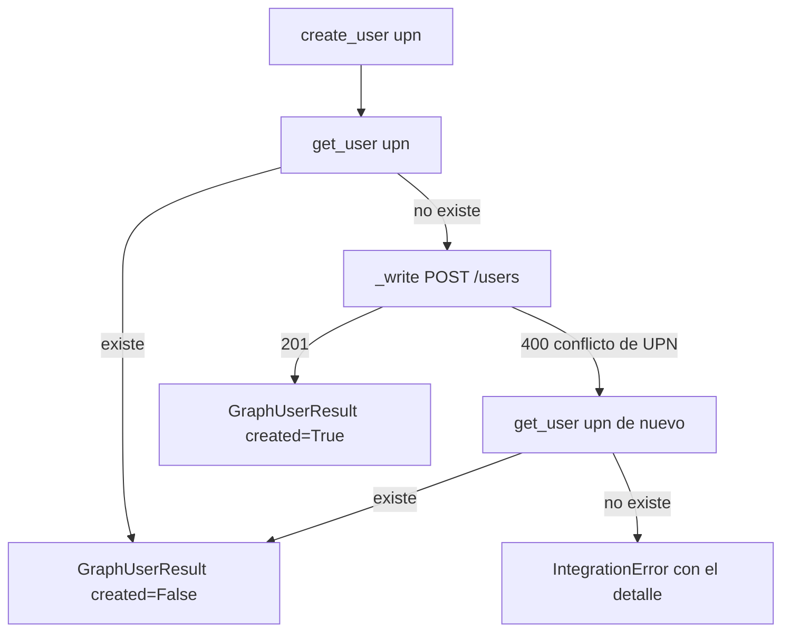

# 01_02 — Clientes de integración externa y adaptadores de servicio

**Módulo:** `apps.integrations` — clientes de comunicación externa (Graph, Moodle, SIAL, SMTP)
**Sistema:** Lucy / Y3P — aprovisionamiento de identidades — FCE / UNRC
**Archivos:** `apps/integrations/exceptions.py`, `apps/integrations/dataclasses.py`, `apps/integrations/services/{base,graph,moodle,sial,mailer}.py`
**Dependencias:** ninguna con el ORM ni con `apps.people`. Sin persistencia en base de datos.
**Estado:** especificación técnica canónica

---

## Índice

1. Para qué existe este módulo
2. Principios de arquitectura y transporte
3. Jerarquía de excepciones
4. DTOs de contrato
5. Convención de simulación (`dry_run`)
6. Adaptador Microsoft Graph
7. Adaptador Moodle REST
8. Adaptador SIAL
9. Adaptador SMTP
10. Invariantes del módulo
11. Verificación y aislamiento en pruebas
12. Defectos del sistema anterior que este módulo elimina
13. Dependencias con el 01_03

---

## 1. Para qué existe este módulo

`apps.integrations` es la frontera entre Lucy y las plataformas externas:

| Servicio | Qué hace Lucy con él |
|---|---|
| Microsoft Entra ID / Graph | Alta de cuentas, licencias A1, contraseñas temporales, reporte de actividad D180 |
| Moodle REST | Consulta y alta de usuarios (`auth=oidc`), matriculación por rol, comisiones y grupos |
| SIAL | Lectura de padrones (preinscriptos, aspirantes, ingresantes) y legajos |
| SMTP | Envío de credenciales temporales y notificaciones |

El módulo **no decide** cuándo crear, matricular o retirar una licencia: eso lo deciden el metamodelo de `apps.people` (01_01) y el orquestador de `apps.provisioning` (01_03). Este módulo solo **ejecuta la orden técnica** de forma tipada, idempotente y consciente de la simulación.

---

## 2. Principios de arquitectura y transporte

```
apps.people / apps.provisioning      ← leen y escriben el ORM
            │  solo escalares y DTOs
            ▼
apps.integrations.services            ← sin ORM, sin transacciones
   BaseIntegrationClient
     ├─ _write()   punto único de escritura, intercepta dry_run
     ├─ _read()    lecturas, siempre reales
     └─ traducción de errores → exceptions.py
            │  HTTPS / SMTP con TLS verificado
            ▼
   Graph     Moodle     SIAL     SMTP
```

**Aislamiento del ORM.** Ningún archivo de `apps/integrations/` importa `apps.people.models` ni abre transacciones. Los clientes se instancian igual en un test, un comando o una tarea de Celery.

**Punto único de escritura.** Toda mutación externa (POST, PUT, PATCH, DELETE, envío SMTP) pasa por `_write()`. Con `dry_run=True`, `_write()` corta antes de resolver DNS o abrir un socket y devuelve el DTO simulado que le pasa el método llamador. Ningún método público escribe por fuera de `_write()`.

**Transporte HTTP.** `httpx.Client` con timeouts explícitos de conexión y lectura. Para Graph se usa `msal.ConfidentialClientApplication` **solo** para adquirir y cachear en memoria el token (scope `https://graph.microsoft.com/.default`). No se usan SDKs de alto nivel.

**Rate limits.** Ningún cliente llama a `time.sleep()`. Ante un HTTP 429 se lee `Retry-After` y se lanza `RateLimitExceededError(retry_after=…)` de inmediato. Reprograma quien llamó (el orquestador), sin retener el worker.

---

## 3. Jerarquía de excepciones

`apps/integrations/exceptions.py`

```python
class IntegrationError(Exception):
    """Base de todas las excepciones del módulo."""
    def __init__(self, message: str, raw_response: object = None):
        super().__init__(message)
        self.raw_response = raw_response


class IntegrationConfigError(IntegrationError):
    """Configuración o credenciales faltantes o inválidas."""


class AuthenticationError(IntegrationError):
    """HTTP 401, token de Graph inválido, Moodle `invalidtoken`."""


class OperationForbiddenError(IntegrationError):
    """HTTP 403, Moodle `nopermissions` / `accessexception`."""


class ResourceNotFoundError(IntegrationError):
    """Recurso que debía existir y no existe (no se usa para consultas de existencia)."""


class ResourceAlreadyExistsError(IntegrationError):
    """Clave o identidad duplicada en el servicio remoto."""


class RateLimitExceededError(IntegrationError):
    """HTTP 429. Trae el tiempo de espera indicado por el servicio."""
    def __init__(self, message: str, retry_after: int = 30, raw_response: object = None):
        super().__init__(message, raw_response)
        self.retry_after = retry_after


class RemoteServiceUnavailableError(IntegrationError):
    """Error transitorio: red, timeout, HTTP 500/502/503/504. Reintentable."""


class ReportConcealedError(IntegrationError):
    """El reporte de M365 llegó con nombres ocultos. No reintentable: requiere cambiar el tenant."""
```

**Cuáles son reintentables:** `RateLimitExceededError` y `RemoteServiceUnavailableError`. El resto indica un problema de configuración, permisos o datos, y reintentar no lo arregla.

---

## 4. DTOs de contrato

`apps/integrations/dataclasses.py`

Reglas:

- Todos son `@dataclass(frozen=True)`.
- Los campos de resultado (`created`, `assigned`, `enrolled`, `sent`…) **no tienen valor por defecto**: un DTO armado a medias no puede informar un éxito.
- Los ids remotos son `Optional`: en simulación no existen.
- Campos en inglés.

```python
from dataclasses import dataclass
from types import MappingProxyType
from typing import Any, Mapping, Optional


@dataclass(frozen=True)
class GraphUserResult:
    id: Optional[str]                 # None en simulación
    user_principal_name: str
    mail_nickname: Optional[str]
    created: bool                     # False si ya existía
    simulated: bool


@dataclass(frozen=True)
class GraphDeleteResult:
    user_identifier: str
    deleted: bool
    simulated: bool


@dataclass(frozen=True)
class LicenseResult:
    sku_id: str
    user_identifier: str              # UPN o id
    assigned: bool                    # True = asignada, False = retirada
    simulated: bool


@dataclass(frozen=True)
class PasswordSetResult:
    user_identifier: str
    simulated: bool                   # nunca lleva la contraseña


@dataclass(frozen=True)
class MoodleUserResult:
    id: Optional[int]                 # None en simulación
    username: str
    email: str
    created: bool
    simulated: bool


@dataclass(frozen=True)
class MoodleEnrollmentResult:
    user_id: Optional[int]
    course_id: int
    role_id: int
    enrolled: bool                    # True = matriculado, False = desmatriculado
    simulated: bool


@dataclass(frozen=True)
class MoodleGroupResult:
    group_id: Optional[int]           # None si el grupo se creó en simulación
    course_id: int
    user_id: Optional[int]
    action: str                       # "CREATED" | "ADDED" | "REMOVED"
    simulated: bool


@dataclass(frozen=True)
class SialStudentDTO:
    document: str
    last_name: str
    first_name: str
    email: str
    career_code: str
    raw_condition: str                # texto de SIAL: PREINSCRIPTO | ASPIRANTE | INGRESANTE
    details: Mapping[str, Any]        # inmutable: MappingProxyType

    @classmethod
    def create(cls, *, document, last_name, first_name, email,
               career_code, raw_condition, details: dict):
        return cls(
            document=document, last_name=last_name, first_name=first_name,
            email=email, career_code=career_code, raw_condition=raw_condition,
            details=MappingProxyType(dict(details)),
        )


@dataclass(frozen=True)
class MailDeliveryResult:
    recipient: str
    subject: str
    sent: bool
    simulated: bool
```

`SialStudentDTO` contiene un `MappingProxyType`, así que no es *hashable*: no se usa como clave de diccionario ni en un `set`. Para deduplicar se usa `document`.

---

## 5. Convención de simulación (`dry_run`)

**Regla:** en simulación, los campos de resultado informan **lo que habría pasado**, con `simulated=True`.

| Operación | `dry_run=True` | `dry_run=False` |
|---|---|---|
| Lecturas (`get_user`, `get_user_by_username`, padrones SIAL, D180) | Llamada real | Llamada real |
| `create_user` (Graph o Moodle) | `created=True, simulated=True, id=None` | Llamada real |
| `assign_license` / `remove_license` | `assigned=True/False, simulated=True` | Llamada real |
| `set_temporary_password` | `PasswordSetResult(simulated=True)` | Llamada real |
| `enrol_user` / `unenrol_user` | `enrolled=True/False, simulated=True` | Llamada real |
| `create_group` | `group_id=None, action="CREATED", simulated=True` | Llamada real |
| `send_email` | `sent=True, simulated=True`, sin abrir socket | Envío real |

Por qué importa: si la simulación devolviera `sent=False` o `created=False`, el orquestador lo leería como un fallo o como "ya existía" y tomaría otra rama. Una corrida simulada tiene que recorrer **el mismo camino** que la real.

Las lecturas son reales también en simulación: así la corrida simulada parte del estado verdadero (por ejemplo, detecta que un usuario ya existe).

---

## 6. Adaptador Microsoft Graph

`services/graph.py` · `httpx.Client` contra `https://graph.microsoft.com/v1.0` · token con `msal`

### 6.1 Identificadores

Todos los métodos que operan sobre un usuario aceptan `user_identifier`: el id (GUID) o el `userPrincipalName`. Graph acepta ambos en la ruta (`/users/{id-o-upn}`). Así, en simulación, donde `create_user` devuelve `id=None`, los pasos siguientes usan el UPN y la cadena no se corta.

### 6.2 `create_user()` idempotente



- **Consulta previa:** la existencia se decide leyendo, no interpretando errores.
- **Payload obligatorio:** `accountEnabled`, `displayName`, `mailNickname`, `userPrincipalName`, `usageLocation="AR"` (sin país, la asignación de licencia falla) y `passwordProfile` con una clave aleatoria descartable (`secrets.token_urlsafe(32)`) y `forceChangePasswordNextSignIn=True`. Esa clave no se devuelve ni se registra: nadie debe conocerla. La clave real la fija `set_temporary_password()`.
- **Conflicto por carrera:** Graph no responde 409 ante un UPN duplicado, sino **400**. Se reconoce como conflicto si `error.details` contiene `code == "ObjectConflict"` con `target == "userPrincipalName"`; como respaldo, si el mensaje menciona que `userPrincipalName` ya existe. En ambos casos se **vuelve a consultar**: si el usuario existe, otro proceso lo creó y se devuelve `created=False`. Comparar el texto es solo una pista; la confirmación es la consulta.

### 6.3 Licencias

```
POST /v1.0/users/{user_identifier}/assignLicense
{"addLicenses": [{"skuId": "<sku>"}], "removeLicenses": []}
```

`assign_license(user_identifier, sku_id)` y `remove_license(user_identifier, sku_id)` usan el mismo endpoint. Las dos claves del payload van siempre, aunque una esté vacía. Requieren que el usuario tenga `usageLocation`.

### 6.4 `set_temporary_password()`

```python
def set_temporary_password(self, user_identifier: str, password: str) -> PasswordSetResult:
    """
    PATCH /v1.0/users/{user_identifier}
    {"passwordProfile": {"forceChangePasswordNextSignIn": true, "password": password}}
    """
```

La contraseña entra como argumento y no sale en el DTO, en logs ni en excepciones.

### 6.5 Reporte de actividad D180

`get_teams_activity_d180()` invoca `GET /v1.0/reports/getTeamsUserActivityUserDetail(period='D180')`, sigue la redirección a la URL temporal y descarga el CSV **sin** reenviar la cabecera `Authorization`.

**Nombres ocultos.** Microsoft 365 puede ocultar los datos de usuario en los reportes; en ese caso los identificadores llegan como hashes opacos.

- Si **algún** registro llega con identificador oculto (no es una dirección de correo), se lanza `ReportConcealedError` y no se devuelve nada.
- Los registros con dirección de correo de **otro** dominio (invitados) se descartan, con un aviso en el log.

**Por qué no se descartan los ocultos en silencio:** un reporte sin filas válidas parecería un tenant donde nadie usó Teams. Si alguna regla posterior retira licencias por inactividad, retiraría la de todos. Ante datos ocultos, el cliente tiene que fallar, no devolver vacío.

---

## 7. Adaptador Moodle REST

`services/moodle.py` · `POST /webservice/rest/server.php?moodlewsrestformat=json`

### 7.1 Errores sobre HTTP 200

Moodle responde 200 incluso cuando falla, con `{"exception", "errorcode", "message"}` en el cuerpo. El cliente inspecciona el JSON en cada respuesta:

| `errorcode` | Excepción |
|---|---|
| `invalidtoken` | `AuthenticationError` |
| `accessexception`, `nopermissions` | `OperationForbiddenError` |
| `invalidparameter` en `create_user` | Ver 7.3 (posible carrera) |
| Cualquier otro | `IntegrationError(message)` |

Los errores HTTP reales (5xx, timeout) se traducen a `RemoteServiceUnavailableError`, como en los demás clientes.

### 7.2 Consulta de existencia

`get_user_by_username(username)` llama a `core_user_get_users_by_field(field="username", values=[username])`. Una lista vacía devuelve `None`: **la ausencia no es un error**. `ResourceNotFoundError` no se usa para consultas de existencia.

### 7.3 `create_user()` idempotente

1. `get_user_by_username(username)`. Si existe → `MoodleUserResult(created=False)`.
2. Si no existe → `_write` de `core_user_create_users` con `auth="oidc"` y el UPN institucional en `username` y `email`. El correo personal nunca reemplaza al institucional.
3. Si falla con `invalidparameter` → se vuelve a consultar:
   - existe → otro proceso lo creó: se devuelve `MoodleUserResult(created=False)`, sin fallar;
   - no existe → `IntegrationError` con el detalle recibido.

El duplicado nunca se detecta leyendo el texto del error (defecto H-17).

### 7.4 Operaciones soportadas

`core_user_get_users_by_field`, `core_user_create_users`, `core_course_get_courses_by_field`, `enrol_manual_enrol_users`, `enrol_manual_unenrol_users`, `core_group_create_groups`, `core_group_add_group_members`, `core_group_remove_group_members`.

**Cambio de comisión:** primero se agrega al grupo nuevo y después se quita del anterior. Si falla el segundo paso, el alumno queda en dos grupos (recuperable) en lugar de en ninguno.

### 7.5 Ritmo de llamadas

El cliente no hace pausas. El ritmo de 0,4 s por llamada (150 por minuto) lo garantiza Celery:

- las operaciones de Moodle corren en una **tarea propia**, enrutada a la cola `moodle`;
- esa tarea declara `rate_limit="150/m"`;
- la cola `moodle` la atiende **un solo worker con concurrencia 1**.

El `rate_limit` de Celery es por tipo de tarea y por worker, no por cola: por eso hacen falta las tres condiciones. Ver la sección 13.

---

## 8. Adaptador SIAL

`services/sial.py` · HTTPS con Basic Auth y verificación de certificado

- `get_student_lists(conditions)` → lista de `SialStudentDTO` para preinscriptos, aspirantes e ingresantes.
- `get_student_details(document)` → datos personales y de carrera.

**Atomicidad de la lectura:** si falla cualquiera de las tres listas, se lanza la excepción y no se devuelve ninguna. Una sincronización con listas parciales cruzaría mal los estados.

**Normalización:** el documento se sanea (sin el sufijo `.0` de los campos numéricos importados de planillas, sin espacios) y se valida como numérico.

**Desacople:** `raw_condition` llega tal como lo informa SIAL. La traducción a estados del metamodelo (PRE, ASP, INGRE) vive en un solo lugar: el orquestador.

---

## 9. Adaptador SMTP

`services/mailer.py` · `smtplib` con certificado verificado

- Puerto 587: `STARTTLS` con `ssl.create_default_context()`, que valida certificado y nombre de host.
- Puerto 465: `smtplib.SMTP_SSL` con el mismo contexto.
- Nunca `CERT_NONE` ni `starttls()` sin contexto.

**Errores:**

| Situación | Resultado |
|---|---|
| Fallo de conexión, TLS o rechazo temporal del servidor | `RemoteServiceUnavailableError` (reintentable) |
| Autenticación SMTP fallida | `AuthenticationError` |
| Dirección inválida detectada antes de enviar | `MailDeliveryResult(sent=False, simulated=False)` (no reintentable) |
| Simulación | `MailDeliveryResult(sent=True, simulated=True)` |

**Plantillas:** se inyectan `{full_name}`, `{upn}` y `{password}` al momento del envío.

**Contraseñas temporales:** el cliente no las genera ni las guarda. El orquestador ejecuta un único paso "fijar y enviar": genera la clave, llama a `set_temporary_password()` y despacha el correo. Si el envío falla, el reintento genera otra clave. El paso es idempotente y ningún secreto se persiste.

---

## 10. Invariantes del módulo

1. **Aislamiento de escritura:** con `dry_run=True` no sale ninguna escritura hacia Graph, Moodle ni SMTP, porque toda escritura pasa por `_write()` y el test de la sección 11 lo verifica.
2. **Tipado:** todo método público devuelve un DTO, `None` (solo en consultas de existencia) o lanza una subclase de `IntegrationError`. Nada de tuplas ni booleanos sueltos.
3. **Secretos:** ninguna excepción, log ni DTO contiene tokens, secretos de aplicación, contraseñas de cuentas ni claves SMTP.
4. **TLS:** todas las conexiones verifican certificado.
5. **Existencia por lectura:** "ya existe" se determina consultando, nunca interpretando el texto de un error.
6. **Sin pausas:** ningún cliente duerme el hilo.

---

## 11. Verificación y aislamiento en pruebas

En `tests/integrations/`:

- **Red bloqueada:** toda la suite corre con un transporte de `httpx` que falla ante cualquier petición no registrada (`respx` o `httpx.MockTransport`) y con `socket.create_connection` bloqueado para SMTP.
- **Garantía de `_write()`:** para cada método de escritura, una prueba con `dry_run=True` y ninguna ruta de escritura registrada verifica que no hubo tráfico y que el DTO tiene `simulated=True` con los campos de resultado de la tabla de la sección 5.
- **Idempotencia:** pruebas del camino "ya existe" y del camino "carrera" de `create_user` en Graph y en Moodle.
- **D180:** un CSV con un identificador oculto debe lanzar `ReportConcealedError`.
- **Secretos:** las pruebas de error verifican que el mensaje de la excepción no contiene la contraseña ni el token usados.

---

## 12. Defectos del sistema anterior que este módulo elimina

| Defecto | Problema anterior | Solución |
|---|---|---|
| H-03 (crítica) | La simulación se controlaba en las vistas; los procesos de fondo escribían de verdad | `dry_run` dentro de cada cliente, en el punto único `_write()` |
| H-04 / H-05 (alta) | Contraseña SMTP expuesta en formularios; STARTTLS sin validar certificado | Credenciales fuera de formularios; TLS siempre con `ssl.create_default_context()` |
| H-06 (alta) | Se asumía éxito sin confirmación remota | Solo un DTO devuelto por la API confirma un resultado |
| H-11 (alta) | Fallos de licencia con contraseñas cruzadas o cuentas sin licencia | Pasos separados; clave descartable al crear; "fijar y enviar" como paso único |
| H-17 (media) | Éxito en Moodle detectado buscando `"already exists"` en el texto | Existencia por consulta previa y reconsulta ante carrera |

---

## 13. Dependencias con el 01_03

Este documento asume tres cosas del orquestador:

1. **Las operaciones de Moodle van en una tarea propia**, enrutada a la cola `moodle` (sección 7.5). Si la saga ejecuta Graph, Moodle y SMTP dentro de una sola tarea, el `rate_limit` frenaría también a Graph y SMTP, o no frenaría a Moodle.
2. **El orquestador reprograma** ante `RateLimitExceededError` usando `retry_after`, y ante `RemoteServiceUnavailableError` con backoff. Las demás excepciones marcan el paso como fallo definitivo.
3. **El paso "fijar contraseña y enviar" es uno solo**, y se omite si `create_user` devolvió `created=False` (cuenta preexistente).

---

*Documento 01_02 de la serie técnica de Lucy. El 01_03 cubre el orquestador de aprovisionamiento y el outbox transaccional.*
