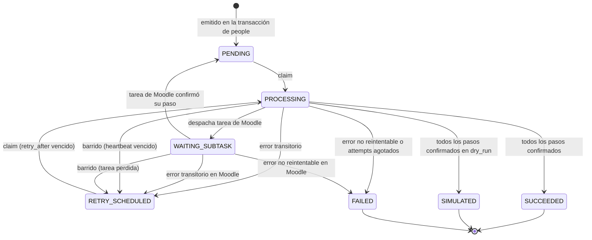

# 01_03 — Outbox transaccional y orquestador de aprovisionamiento

**Módulos:** `apps.people` (produce y guarda el outbox) · `apps.provisioning` (consume y orquesta)
**Sistema:** Lucy / Y3P — aprovisionamiento de identidades — FCE / UNRC
**Archivos:** `apps/people/models.py` (OutboxEvent), `apps/provisioning/{dispatcher,orchestrator,tasks,sweeper,admin}.py`
**Depende de:** 01_01 (metamodelo y servicios), 01_02 (clientes de integración)
**Estado:** especificación técnica canónica

---

## Índice

1. Para qué existe
2. Decisiones que estructuran el diseño
3. Dirección de dependencias
4. Qué emite eventos: acciones de aprovisionamiento por estado
5. Modelo de datos: OutboxEvent
6. Estados del evento
7. Reclamo de eventos (claim) y orden por identidad
8. Sagas: aprovisionar, suspender, dar de baja
9. Paso "fijar contraseña y enviar"
10. Topología Celery y continuación por Moodle
11. Reintentos y errores
12. Barrido de eventos colgados
13. Simulación
14. Invariantes
15. Pruebas requeridas
16. Cambios requeridos en 01_01 y 01_02
17. Decisiones pendientes

---

## 1. Para qué existe

Convierte los cambios de estado de `apps.people` en operaciones remotas sobre Microsoft 365, Moodle y SMTP, con cuatro garantías:

- **Atomicidad local:** si la transacción de `apps.people` se revierte, no existe evento y no ocurre ninguna operación remota.
- **Durabilidad:** si se reinicia el servidor web, un worker o Redis, el evento sigue en PostgreSQL y se retoma.
- **Avance por checkpoints:** un paso confirmado no se repite en los reintentos.
- **Credenciales sin persistencia:** la contraseña temporal se fija y se envía en un solo paso; nunca se guarda.

---

## 2. Decisiones que estructuran el diseño

| Decisión | Motivo |
|---|---|
| **El agregado es la `Identity`, no la `Affiliation`** | La cuenta de Entra ID y la licencia pertenecen a la persona, no a cada carrera. Con orden por vinculación, el alta de la carrera B y el vencimiento de la carrera A de la misma persona correrían en paralelo sobre la misma cuenta. |
| **El outbox vive en el productor (`apps.people`)** | Es la regla del patrón: el evento se escribe en la misma base y el mismo módulo que el cambio que lo origina. Así `apps.people` no depende de `apps.provisioning`. |
| **Los eventos se emiten al entrar a un estado, no por regla** | Lo que hay que aprovisionar depende del estado en que queda la vinculación, no del camino por el que llegó. Cubre también el alta (que no es una transición) y evita configurar lo mismo en varias reglas. |
| **Los tipos de evento son intenciones: `PROVISION`, `SUSPEND`, `TERMINATE`** | Son idempotentes: reemitir `PROVISION` es seguro y sirve como resincronización. |
| **PostgreSQL es la única fuente de verdad de los reintentos** | Sin `self.retry()` de Celery: un mensaje en Redis se pierde si Redis se reinicia, y convivir con un barrido que también reprograma duplica ejecuciones. |
| **Moodle corre como continuación, no como subtarea esperada** | Esperar el resultado de una tarea dentro de otra tarea bloquea el worker y puede trabar el pool. |
| **Las bajas se deciden con el estado actual de la persona** | Retirar la licencia porque venció una carrera dejaría sin licencia a quien sigue activo en otra. |

---

## 3. Dirección de dependencias

```
apps.integrations   ← no conoce a nadie
        ▲
apps.provisioning   → lee apps.people (ORM) y usa apps.integrations
        │
        ▼
apps.people         ← escribe OutboxEvent en la misma transacción; no importa provisioning
```

`apps.people` solo conoce el modelo `OutboxEvent` (propio) y encola el despachador por nombre de tarea, sin importar código de `apps.provisioning`:

```python
transaction.on_commit(
    lambda: current_app.send_task("provisioning.dispatch_outbox")
)
```

---

## 4. Qué emite eventos: acciones de aprovisionamiento por estado

Dos campos nuevos en `SagaStatusDefinition` (01_01):

```python
class ProvisioningAction(models.TextChoices):
    PROVISION = "PROVISION", "Aprovisionar"
    SUSPEND = "SUSPEND", "Suspender"
    TERMINATE = "TERMINATE", "Dar de baja"

provisioning_action = models.CharField(
    max_length=16, choices=ProvisioningAction.choices, blank=True,
    help_text="Acción que se emite al ENTRAR a este estado. Vacío = ninguna.",
)
requires_m365_license = models.BooleanField(
    default=False,
    help_text="Una vinculación activa en este estado necesita licencia A1.",
)
```

**Emisión.** En `services._apply()` y en `services.create_affiliation()`, dentro de la misma transacción, después de escribir el historial:

```python
if new_status.provisioning_action:
    OutboxEvent.objects.create(
        action=new_status.provisioning_action,
        identity_id=affiliation.identity_id,
        affiliation_id=affiliation.id,
        payload=build_outbox_payload(affiliation),
    )
    transaction.on_commit(lambda: current_app.send_task("provisioning.dispatch_outbox"))
```

**Ejemplo con la semilla de la FCE:**

| Estado | `provisioning_action` | `requires_m365_license` |
|---|---|---|
| PRE, ASP | — | No |
| INGRE, ALUMNO | `PROVISION` | Sí |
| BAJA_PRE, BAJA_ASP | — | No (nunca se aprovisionó) |
| GRADUADO | `SUSPEND` | No |
| PROFESOR:SI | `PROVISION` | Sí |
| PROFESOR:NO | `SUSPEND` | No |

Los valores concretos son una decisión institucional; el mecanismo no cambia.

**Renovación.** `renew_affiliation()` (01_01, decisión pendiente 1) no cambia de estado y no emite: los recursos ya existen. Para resincronizar a alguien se emite un `PROVISION` manual, que es idempotente.

---

## 5. Modelo de datos: OutboxEvent

`apps/people/models.py`

```python
class OutboxEvent(models.Model):
    class Status(models.TextChoices):
        PENDING = "PENDING", "Pendiente"
        PROCESSING = "PROCESSING", "En proceso"
        WAITING_SUBTASK = "WAITING_SUBTASK", "Esperando tarea de Moodle"
        RETRY_SCHEDULED = "RETRY_SCHEDULED", "Reintento programado"
        SUCCEEDED = "SUCCEEDED", "Completado"
        SIMULATED = "SIMULATED", "Completado en simulación"
        FAILED = "FAILED", "Fallo definitivo"

    # PK autoincremental: da el orden de llegada sin empates.
    id = models.BigAutoField(primary_key=True)
    public_id = models.UUIDField(default=uuid.uuid4, unique=True, editable=False)

    action = models.CharField(max_length=16, choices=ProvisioningAction.choices)
    identity = models.ForeignKey("Identity", on_delete=models.PROTECT, related_name="outbox_events")
    affiliation = models.ForeignKey("Affiliation", on_delete=models.PROTECT, related_name="outbox_events")

    # Datos para EJECUTAR (UPN, nombres, correo de destino, cursos).
    # Las DECISIONES sobre otras vinculaciones se leen al ejecutar, no de acá.
    payload = models.JSONField()

    # Checkpoints: {"graph_user": {"status": "CONFIRMED", "created": true, "simulated": false}, ...}
    step_results = models.JSONField(default=dict, blank=True)

    status = models.CharField(max_length=20, choices=Status.choices,
                              default=Status.PENDING, db_index=True)
    attempts = models.PositiveIntegerField(default=0)
    max_attempts = models.PositiveIntegerField(default=10)
    last_error = models.TextField(blank=True)
    retry_after = models.DateTimeField(null=True, blank=True)

    locked_at = models.DateTimeField(null=True, blank=True)
    heartbeat_at = models.DateTimeField(null=True, blank=True)
    created_at = models.DateTimeField(auto_now_add=True)
    processed_at = models.DateTimeField(null=True, blank=True)

    class Meta:
        db_table = "people_outbox_events"
        indexes = [
            models.Index(fields=["status", "retry_after"]),
            models.Index(fields=["identity", "id"]),
        ]
```

**Por qué `BigAutoField` y no UUID como PK:** el orden por identidad necesita saber qué evento llegó antes. Un UUIDv4 no tiene orden, y `created_at` puede empatar entre eventos creados en la misma transacción. El UUID queda como `public_id` para exponer en la API o en logs.

**Por qué FK reales:** el outbox vive en `apps.people`, así que puede usar claves foráneas protegidas en lugar de un entero suelto.

**Escritura de checkpoints:** cada actualización de `step_results` se hace en una transacción corta que relee la fila con `select_for_update()`, aplica el cambio y guarda. Nunca se guarda un `step_results` leído minutos antes.

---

## 6. Estados del evento



| Estado | Reclamable | Bloquea eventos posteriores de la misma identidad |
|---|---|---|
| PENDING | Sí | Sí |
| RETRY_SCHEDULED | Sí, si `retry_after <= ahora` | Sí |
| PROCESSING | No | Sí |
| WAITING_SUBTASK | No | Sí |
| FAILED | No | **Sí**, hasta intervención |
| SUCCEEDED, SIMULATED | No | No |

**Por qué FAILED bloquea:** si falló el `PROVISION` de una persona, ejecutar después su `SUSPEND` actuaría sobre un estado remoto desconocido. Un FAILED dispara una alerta; un operador lo corrige y lo rearma (vuelve a PENDING) o lo cancela explícitamente, y recién ahí avanza la cola de esa persona.

---

## 7. Reclamo de eventos (claim) y orden por identidad

El despachador reclama en una **transacción corta** y la cierra antes de cualquier llamada de red.

```sql
SELECT e.id
FROM people_outbox_events e
WHERE (e.status = 'PENDING'
       OR (e.status = 'RETRY_SCHEDULED' AND e.retry_after <= now()))
  AND NOT EXISTS (
        SELECT 1 FROM people_outbox_events p
        WHERE p.identity_id = e.identity_id
          AND p.id < e.id
          AND p.status NOT IN ('SUCCEEDED', 'SIMULATED'))
ORDER BY e.id
LIMIT 1
FOR UPDATE SKIP LOCKED;

-- en la misma transacción:
UPDATE people_outbox_events
SET status = 'PROCESSING', locked_at = now(), heartbeat_at = now()
WHERE id = :id;
COMMIT;
```

En Django, la subconsulta es un `~Exists(...)` y el bloqueo es `select_for_update(skip_locked=True)`.

**Reglas:**

- **Ningún lock abierto durante la red.** Tras el `COMMIT` del claim, la fila queda en PROCESSING sin bloqueo; los pasos remotos corren fuera de toda transacción.
- **Un evento por identidad a la vez.** El `NOT EXISTS` impide tomar un evento si hay uno anterior de la misma persona sin terminar. Si dos workers compiten, el que llega segundo ve el evento anterior como PENDING o PROCESSING y lo saltea.
- **Latido por paso.** `heartbeat_at` se actualiza al terminar cada paso, junto con su checkpoint. Una sola llamada de red no puede actualizarlo mientras espera, así que el umbral del barrido debe superar el timeout de lectura más largo de los clientes.

---

## 8. Sagas

Cada paso: si su checkpoint ya está `CONFIRMED` o `SKIPPED_*`, se saltea. Si no, se ejecuta, se asienta el checkpoint y se actualiza el latido.

### 8.1 `PROVISION`

| # | Paso | Ejecuta | Comportamiento |
|---|---|---|---|
| 1 | `graph_user` | `MicrosoftGraphClient.create_user()` | Lee antes de crear (01_02 §6.2). Asienta `created` (True = cuenta nueva). |
| 2 | `license` | `assign_license(upn, sku)` | Usa el UPN, así funciona también en simulación. |
| 3 | `moodle` | Tarea `provisioning.moodle_step` en la cola `moodle` | Alta idempotente, matrículas y grupos. Ver §10. |
| 4 | `password_and_mail` | Orquestador | Solo si `graph_user.created == True`. Si no: `SKIPPED_EXISTING_USER`. Ver §9. |

El paso 4 va al final para que el correo llegue cuando la cuenta ya tiene licencia y acceso a Moodle.

### 8.2 `SUSPEND`

Antes de cada paso, el orquestador lee **el estado actual** de la identidad: sus otras vinculaciones activas y sus estados.

| # | Paso | Ejecuta | Comportamiento |
|---|---|---|---|
| 1 | `moodle` | Tarea en cola `moodle` | Desmatricula solo de los cursos de **esta** vinculación. Conserva grupos históricos según reglas de negocio. |
| 2 | `license` | `remove_license(upn, sku)` | Solo si ninguna otra vinculación activa está en un estado con `requires_m365_license`. Si alguna lo está: `SKIPPED_STILL_REQUIRED`. |
| 3 | `graph_disable` | `disable_user(upn)` | Solo si la identidad no tiene ninguna vinculación activa. Si tiene: `SKIPPED_STILL_ACTIVE`. |

### 8.3 `TERMINATE`

Igual que `SUSPEND`, más un paso final `graph_delete` (`delete_user`) **solo** si la identidad no tiene vinculaciones activas y la política institucional lo habilita (decisión pendiente 2). Mientras no se decida, `TERMINATE` se comporta como `SUSPEND`.

**Por qué leer el estado actual y no el payload:** el payload es una foto del momento de la emisión. Si entre la emisión y la ejecución la persona ganó otra vinculación, la foto diría "retirar licencia" y la realidad, "conservarla".

---

## 9. Paso "fijar contraseña y enviar"

```python
def password_and_mail_step(graph, mailer, *, upn, full_name, recipient):
    password = generate_temporary_password()          # política institucional
    graph.set_temporary_password(user_identifier=upn, password=password)
    result = mailer.send_credentials_email(
        recipient=recipient, full_name=full_name, upn=upn, password=password,
    )
    del password
    return result
```

- **La cuenta nace con una clave descartable** (01_02 §6.2) que nadie conoce.
- **Fijar y enviar es un único paso.** Si el envío falla, el checkpoint queda sin confirmar; el reintento genera **otra** clave, la fija y vuelve a enviar.
- **Doble correo posible.** Si el worker muere después de enviar y antes de asentar el checkpoint, el reintento manda un segundo correo con otra clave. La última es la válida. Es preferible a perder el envío; el texto del correo debe decir "si recibiste más de un mensaje, usá el más reciente".
- **Cuentas preexistentes:** si `graph_user.created == False`, el paso se registra como `SKIPPED_EXISTING_USER` y no se toca la contraseña.
- **`MailDeliveryResult(sent=False)`** (dirección inválida detectada antes de enviar) es un fallo **no reintentable**: el evento va a FAILED con la dirección en `last_error`.

---

## 10. Topología Celery y continuación por Moodle

```
Redis (broker)
├── cola provisioning      dispatch_outbox, run_saga        N workers
└── cola moodle            moodle_step                      1 worker, -c 1, rate_limit="150/m"

Celery Beat
├── dispatch_outbox        cada 1 min (respaldo del on_commit)
└── sweep_stuck_events     cada 5 min
```

**Continuación, no espera.** El orquestador nunca llama a `result.get()` dentro de una tarea. Al llegar al paso Moodle:

1. El orquestador pasa el evento a `WAITING_SUBTASK`, encola `moodle_step(event_id)` y **termina**.
2. `moodle_step` ejecuta las operaciones de Moodle (con el ritmo de la cola), asienta el checkpoint `moodle` y devuelve el evento a `PENDING`.
3. Encola `dispatch_outbox`. Un worker de `provisioning` reclama el evento y sigue desde el paso siguiente.

Si `moodle_step` falla, aplica la misma política de errores de §11 sobre el evento. Si el mensaje se pierde (por ejemplo, Redis se reinicia), el barrido lo recupera (§12).

**Ritmo de Moodle:** el `rate_limit` de Celery es por tipo de tarea y por worker. Funciona porque `moodle_step` es la única tarea de la cola `moodle` y esa cola tiene un solo worker con concurrencia 1.

---

## 11. Reintentos y errores

La política se aplica **en la base**: el evento pasa a `RETRY_SCHEDULED` con `retry_after`, la tarea termina y el despachador lo vuelve a reclamar cuando corresponde. No se usa `self.retry()`.

| Excepción | Efecto |
|---|---|
| `RateLimitExceededError` | `RETRY_SCHEDULED`, `retry_after = ahora + exc.retry_after`. **No** suma intento: el servicio pidió esperar, el evento no falló. |
| `RemoteServiceUnavailableError` | `attempts += 1`, `RETRY_SCHEDULED` con backoff. |
| `AuthenticationError`, `OperationForbiddenError`, `IntegrationConfigError`, `ReportConcealedError` | `FAILED` inmediato + alerta. Reintentar no lo arregla. |
| `MailDeliveryResult(sent=False)` | `FAILED` + alerta (dirección inválida). |
| Otra `IntegrationError` | `attempts += 1`, `RETRY_SCHEDULED`. |
| Cualquier otra excepción | `attempts += 1`, `RETRY_SCHEDULED`, traza en el log (sin secretos). Un error de programación no debe dejar el evento colgado en PROCESSING. |

**Backoff:**

```python
delay = min(2 ** attempts * 30, 3600) + random.randint(0, 30)   # segundos
```

Con `max_attempts = 10` la espera acumulada ronda las **5 horas**: cubre una caída de Moodle o del SMTP de una tarde sin intervención. Con 5 intentos y base de 15 s (versión anterior) el total era de unos 15 minutos, y cualquier corte más largo terminaba en FAILED.

**Agotado:** si tras sumar el intento `attempts >= max_attempts`, el evento pasa a FAILED en lugar de reprogramarse.

**Cada transición de error** asienta en la misma escritura: `status`, `attempts`, `retry_after`, `last_error`, el checkpoint del paso (`FAILED` con el mensaje) y, si es terminal, `processed_at`.

---

## 12. Barrido de eventos colgados

`sweep_stuck_events`, cada 5 minutos:

| Situación | Umbral | Acción |
|---|---|---|
| `PROCESSING` con `heartbeat_at` viejo | 5 min (mayor que el timeout de lectura más largo) | `RETRY_SCHEDULED`, `retry_after = ahora`, `attempts += 1` |
| `WAITING_SUBTASK` sin cambios | 2 h | `RETRY_SCHEDULED`, `retry_after = ahora`, `attempts += 1` |

Un worker muerto cuenta como intento: si un evento hace caer al worker cada vez, termina en FAILED en lugar de reciclarse para siempre.

**Entrega al menos una vez.** Si un worker muere entre el éxito remoto y la escritura del checkpoint, ese paso se ejecuta de nuevo. Por eso **todos los pasos deben ser idempotentes**: crear lee antes; asignar o retirar licencia y matricular son repetibles; "fijar y enviar" genera otra clave (§9).

---

## 13. Simulación

Con `LUCY_DRY_RUN = True`, el orquestador crea los clientes con `dry_run=True`. Los pasos devuelven DTOs con `simulated=True`, se asientan en `step_results` y el evento termina en **`SIMULATED`**, no en `SUCCEEDED`.

**Por qué un estado propio:** si una corrida simulada sobre la base real marcara los eventos como SUCCEEDED, al pasar a modo real esos eventos ya estarían "hechos" y las cuentas nunca se crearían. `SIMULATED` es terminal para la corrida simulada, y el comando:

```bash
python manage.py rearm_simulated_events            # SIMULATED → PENDING, limpia step_results
python manage.py rearm_simulated_events --dry-run  # informa cuántos rearmaría
```

los devuelve a la cola cuando se activa el modo real.

`SIMULATED` no bloquea eventos posteriores de la misma identidad, para que una simulación completa pueda recorrer toda la cola.

---

## 14. Invariantes

1. **Atomicidad local:** no existe un `OutboxEvent` cuya transacción de origen se haya revertido.
2. **Un evento activo por identidad:** nunca hay dos eventos de la misma identidad en PROCESSING o WAITING_SUBTASK.
3. **Orden por identidad:** un evento no se ejecuta mientras exista uno anterior de la misma identidad que no esté en SUCCEEDED o SIMULATED.
4. **Sin locks durante la red:** ninguna transacción de base de datos queda abierta mientras se llama a un cliente.
5. **Checkpoints:** un paso `CONFIRMED` no se reejecuta *por decisión del orquestador*. Puede reejecutarse solo si el worker murió antes de asentarlo, y por eso todo paso es idempotente.
6. **Escritura solo por clientes:** ninguna mutación remota ocurre fuera de `apps.integrations` (y, dentro, fuera de `_write()`).
7. **Bajas con estado actual:** no se retira una licencia ni se deshabilita una cuenta sin verificar las demás vinculaciones activas de la identidad en el momento de ejecutar.
8. **Secretos:** ningún token, secreto ni contraseña temporal aparece en `payload`, `step_results`, `last_error` ni en logs.
9. **Simulación no consume:** un evento procesado en simulación nunca queda como SUCCEEDED.

---

## 15. Pruebas requeridas

En `tests/provisioning/`, con los clientes en simulación o con dobles:

- **Atomicidad:** una transición que se revierte deja `OutboxEvent` vacío.
- **Emisión por estado:** entrar a INGRE emite `PROVISION`; entrar a ASP no emite; el alta directa en un estado con acción también emite.
- **Claim sin lock:** tras el claim, otra conexión puede leer y actualizar la fila; el evento está en PROCESSING con `locked_at` y `heartbeat_at`.
- **Orden por identidad:** dos eventos de la misma persona en cola: el segundo no se reclama hasta que el primero termina; con el primero en FAILED, el segundo no avanza.
- **Paralelo entre identidades:** eventos de personas distintas se reclaman a la vez.
- **Checkpoint:** caída simulada en Moodle tras confirmar Graph y licencia; el reintento no llama a Graph.
- **Continuación:** el paso Moodle deja el evento en WAITING_SUBTASK, `moodle_step` lo devuelve a PENDING y la saga termina en otro worker.
- **Rotación de clave:** fallo SMTP; el reintento llama a `set_temporary_password()` con una clave distinta.
- **Cuenta preexistente:** `created=False` → `SKIPPED_EXISTING_USER`, sin llamada a `set_temporary_password()`.
- **Licencia compartida:** persona con dos carreras; vence una; `remove_license` no se llama (`SKIPPED_STILL_REQUIRED`).
- **Errores:** 429 no suma intento; 503 suma y reprograma; 401 va directo a FAILED; excepción inesperada reprograma sin dejar PROCESSING.
- **Barrido:** PROCESSING con latido viejo vuelve a RETRY_SCHEDULED con un intento más.
- **Simulación:** una corrida termina en SIMULATED; `rearm_simulated_events` la devuelve a PENDING.
- **Secretos:** tras un fallo en el paso de contraseña, ni `step_results` ni `last_error` contienen la clave.

---

## 16. Cambios requeridos en 01_01 y 01_02

**01_01 (`apps.people`):**

- `SagaStatusDefinition.provisioning_action` y `SagaStatusDefinition.requires_m365_license` (§4).
- Modelo `OutboxEvent` en `apps/people/models.py` (§5).
- Emisión en `_apply()` y `create_affiliation()` (§4).
- La semilla debe asignar `provisioning_action` y `requires_m365_license` a cada estado.

**01_02 (`apps.integrations`):**

- `MicrosoftGraphClient.disable_user(user_identifier)` → `PATCH /v1.0/users/{id}` con `{"accountEnabled": false}`, por `_write()`, devolviendo un DTO con `simulated`.
- `MailerClient.send_credentials_email(...)` como método explícito (hoy la plantilla está descrita, pero no el método).

---

## 17. Decisiones pendientes

| # | Tema | Recomendación |
|---|---|---|
| 1 | Qué estados aprovisionan y cuáles requieren licencia | Confirmar la tabla de §4 con la semilla definitiva. |
| 2 | ¿`TERMINATE` borra la cuenta de Entra ID? | Deshabilitar, no borrar: un usuario borrado se recupera solo durante 30 días y después se pierden buzón y archivos. Borrar requiere una decisión institucional explícita. |
| 3 | Retención del outbox | El `payload` contiene datos personales (correo personal). Propuesta: a los 90 días de SUCCEEDED, vaciar `payload` y conservar `step_results` como registro técnico. |
| 4 | Rearmar o cancelar un FAILED | Definir quién puede hacerlo desde el admin y que quede en un registro con actor y motivo, como el historial de 01_01. |

---

*Documento 01_03 de la serie técnica de Lucy.*
